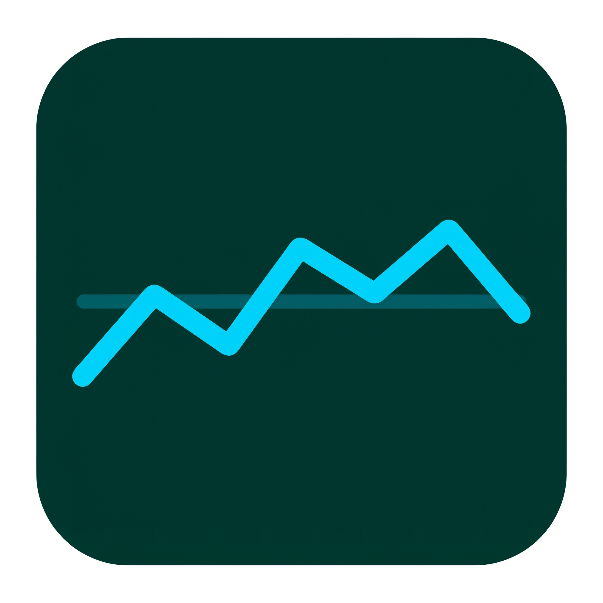

# 康伴 · 个人健康仪表

一个**只跟你自己比**的 Android 健康 App。数据来自小米运动健康（Mi Fitness），
不打卡、不发徽章、不给身体打分，只回答一个问题：

> 今天跟你自己的常态比，怎么样？

<p align="center">
  
</p>

---

## 它和别的健康 App 有什么不同

大多数健康 App 会给你一个分数、一个目标、一个和"同龄人"的比较。这三样东西
在没有临床依据时，要么让人焦虑，要么让人麻木。

这个 App 的设计约束是：

- **只和你的 30 天个人基线比**，不和人群平均比；
- **不给身体打分**（睡眠另有一套明确的方法论，见下）；
- **不把消费级手环数据当诊断**，每个判断都标注依据和局限。

## 功能

### 概览：一眼看到答案

今日主读数 + 与基线的偏离百分比 + 14 天迷你走势；四个副指标（静息心率、
睡眠、平均心率、血氧）可点开查看逐日明细。

### 趋势：基线带

主图上方画一条**你自己的 30 天中位数基线**，以及由四分位距算出的「正常波动带」。
看一眼就知道今天是高于还是低于常态，而不是去比具体数字。

### 睡眠结构 + 睡眠评分

从手环原始数据里解析出深睡 / 浅睡 / **REM** / 清醒的完整分期时间轴，
以及醒来次数、睡眠效率、夜间 HRV、入睡潜伏期、前后半夜心率。

睡眠评分采用**分项计分（总分 100）**，每一维依据如下：

| 维度 | 满分 | 依据 |
|---|---|---|
| 深睡 | 22 | Ohayon 2004（成人 N3 占比随年龄下降）+ Oura 以分钟数判深睡（青年理想 90 min）；百分比与分钟数取高分 |
| 夜间平均心率 | 12 | 与**个人 30 天基线**比（个体差异极大，不用固定值） |
| REM | 10 | AASM / Oura：成人 20~25% |
| 睡眠效率 | 10 | AASM：≥85% 为正常 |
| 连续性 | 10 | AASM：入睡后清醒（WASO）<30 分钟 |
| 作息节律 | 8 | 对比**用户手动设定的目标入睡/起床时间**（入睡与起床各 4 分） |
| 夜间 HRV | 7 | 与个人基线比 |
| 睡眠时长 | 7 | **7~8 小时最优**，双向扣分 |
| 前后半夜心率 | 6 | 前半夜深睡占优 → 心率应 ≤ 后半夜 |
| 夜间最低血氧 | 5 | 用**近 7 天中位数**判（设备误差 ±2~3%，单晚最低值不可靠） |
| 入睡潜伏期 | 3 | Oura Latency：理想 10~20 分钟 |

在三层机制之上再给最终分：

1. **趋势修正（±10）**：只有当今日分与近 7 日均分相差超过 8 分才调整 ——
   异常高扣分（多半是波动，债没还完），异常低补回（是偶然，不该重罚）。
   正常波动不调整。
2. **短板封顶**：深睡 <10% → 总分上限 75；10~13% → 上限 82。一项严重短板
   不能被十项优秀掩盖。
3. **主观调整（±5）**：你自己早上打的睡眠质量分是**附加调整**，不是加权平均。
   主数字永远是纯设备分。

关于「睡太久」：Cappuccio 2010（138 万人）显示睡眠时长与全因死亡率是 **U 型**
关系，9 小时 RR 1.30，比睡不足（6 小时 RR 1.12）还高。但长睡更可能是潜在疾病的
**标志物**而非原因（García-Perdomo 2018），所以界面写的是「值得留意」，不是
「你应该少睡」。

### 早上打卡

每天第一次打开时问一次「昨晚睡得怎么样」——设备测得到时长和分期，测不到你
醒来的感觉。这个主观分只做小幅调整（±5），因为单晚的主观评价本身也不可靠。

历史日期可以补评，避免「没打分的那天显得分数更高」这种不公平。

### 干预记录

记录维生素 D3、鱼油、咖啡、酒精、运动这类**主动变量**。手环测结果、测不到原因。
干预记录会一起发给模型，并明确要求「记录不足 4 周不要下有效/无效结论」——
维生素 D 的血药浓度变化以周计。

### AI 分析（可选）

三种分析模式，走 Anthropic 协议，可对接 MiniMax / DeepSeek（两者都提供
Anthropic 兼容端点）：

- **多天趋势**（7/14/30 天可选）
- **聚焦昨晚**（带前两晚作为参照，避免没有比较基准）
- **全身体检**（30 天全系统评估）

全身体检按 **AHA Life's Essential 8** 框架组织，并且硬性要求模型**承认自己看不全**：

> 设备能判断：睡眠、体力活动、心血管功能、呼吸与氧合、自主神经
> 设备完全没有：血压、血脂、血糖、体重/BMI、饮食、吸烟饮酒、视力口腔等

如果一份「AI 体检」只告诉你「多走路、早点睡」却不说它测不到你的血压血脂血糖，
那是在制造虚假的安全感。

## 隐私边界

这是本项目最重要的设计约束。

| 数据 | 位置 | 是否外发 |
|---|---|---|
| 逐条心率 / 睡眠分期明细 | 手机本地 | ❌ 从不外发 |
| 日聚合数据（步数、心率均值、睡眠结构…） | 手机本地 | ✅ 仅在你点「生成建议」时发给模型 API |
| 主观反馈、干预记录 | 手机本地 | ✅ 同上 |
| API Key、WebDAV 密码、小米凭证 | 手机本地 | ❌ 用 Android Keystore（AES-256）加密存储 |
| 备份快照 | **你自己的 WebDAV 服务器** | ✅ 只上传日聚合，不含逐条明细 |

- 没有后端服务器，没有账号体系，没有埋点统计。
- 凭据用 Android Keystore 加密：密钥生成在 TEE/StrongBox 中，**不可导出**，
  即使有人拿到 SharedPreferences 文件也解不开。
- 网络请求直连你配置的模型 API 和自己的 WebDAV。

## 数据来源

两条路并行，字段级合并：

1. **本机直读**：root 后用 `su -mm` 读取 `com.mi.health` 的 SQLite
   （指标最全，含静息心率、HRV、压力、睡眠分期）；
2. **小米云端**：`hlth.io.mi.com` 的加密接口（跨设备，但没有静息心率和压力）。

没有 root、也不登录小米账号时，App 仍然可以运行，只是没有数据。

## 构建

```bash
# 需要 JDK 17、Android SDK（compileSdk 35）
./gradlew :app:assembleDebug

# 单元测试（睡眠评分边界、加密层跨语言一致性）
./gradlew :app:testDebugUnitTest
```

`local.properties` 里的 `sdk.dir` 需要指向你自己的 Android SDK。
项目自带 `keystore/debug.keystore`（公开的通用调试密钥），也可以删掉让
Gradle 使用默认 debug 签名。

## 免责声明

**本 App 不是医疗器械，任何输出都不构成医学诊断。**

- 消费级手环的睡眠分期与多导睡眠图（PSG）一致率约 76%（Oura 官方数据），
  血氧误差 ±2~3 个百分点；
- 所有评分都是对**估计值**的二次加工，只适合看趋势，不适合看单日绝对值；
- 如果有持续的入睡困难、白天嗜睡、打鼾憋气、心悸胸痛，请就医，而不是看这个 App。

## 许可

MIT
